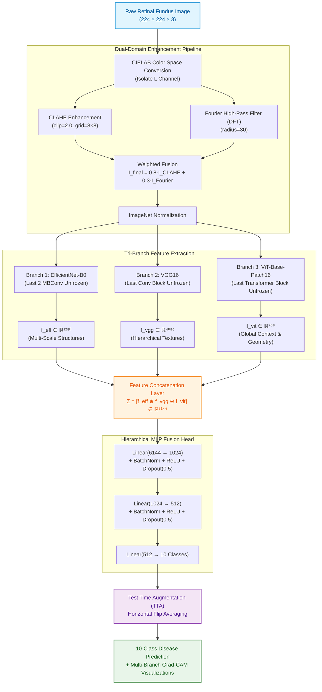

# Advancing Ophthalmic Diagnostics: A Hybrid CNN-Transformer Ensemble with Deep Feature Fusion

[](https://www.python.org/downloads/)
[](https://pytorch.org/)
[](https://github.com/huggingface/pytorch-image-models)
[](https://opencv.org/)
[](LICENSE)
[](https://hstu.ac.bd/)

> **Undergraduate Thesis (Course No.: ECE 402)**  
> Department of Electronics and Communication Engineering  
> **Hajee Mohammad Danesh Science and Technology University (HSTU)**, Dinajpur-5200, Bangladesh  
> *February 2026*

---

## 📌 Abstract & Overview

Ophthalmic conditions like **Diabetic Retinopathy (DR)**, **Glaucoma**, **Disc Edema**, and **Retinal Detachment** are leading causes of preventable blindness worldwide. Conventional Computer-Aided Diagnosis (CAD) systems face a critical dilemma:
- **CNNs** excel at local lesion textures (microaneurysms, hemorrhages) but have limited receptive fields that miss global structural geometry.
- **Vision Transformers (ViTs)** model long-range spatial dependencies (optic disc cup-to-disc ratio, vascular arcades) but lack localized inductive bias on modest medical cohorts.
- **Single-model architectures** typically hit an accuracy ceiling between 75% and 80% on complex multi-class datasets.

This repository presents the official implementation of our **Hybrid CNN-Transformer Ensemble**, combining **EfficientNet-B0**, **VGG16**, and **ViT-Base-Patch16** via early-late deep feature fusion. Evaluated on a 10-class retinal fundus dataset from Bangladesh, our framework breaks the performance plateau to achieve **88.99% Accuracy**, **92.36% Macro Sensitivity**, **0.8718 MCC**, and **0.9934 Macro AUC**.

---

## 🌟 Key Highlights

- 👁️ **Comprehensive 10-Class Disease Spectrum**: Classifies Normal/Healthy retinas and 9 distinct pathologies: *Diabetic Retinopathy, Glaucoma, Disc Edema, Retinal Detachment, Retinitis Pigmentosa, Macular Scar, Myopia, Pterygium, and Color Fundus*.
- 🧬 **Tri-Branch Complementary Fusion**: Integrates compound-scaled multi-scale features (EfficientNet-B0: 1280-D), deep hierarchical textures (VGG16: 4096-D), and global self-attention context (ViT-Base: 768-D) into a unified **6,144-dimensional representation space**.
- 🩻 **Dual-Domain Preprocessing**: Blends **CLAHE** (LAB color space) with **Fourier Domain High-Pass Filtering (HPF, $r=30$)** to accentuate micro-lesions and vascular contours.
- 🎯 **Strategic Unfreezing & Differential Learning**: Freezes 90.4% of backbone weights to prevent catastrophic forgetting; tunes only **22.12M parameters (9.6%)** with differential learning rates ($10^{-5}$ backbones / $10^{-4}$ fusion head).
- 🔍 **Explainable AI (Grad-CAM)**: Multi-branch class activation mapping transparently visualizes model decision boundaries matching clinical ophthalmological criteria.

---

## 🏗️ System Architecture



---

## 📊 Benchmark & Comparative Evaluation

All models were evaluated using a **5-fold Stratified Cross-Validation protocol** and tested on an independent hold-out set ($N = 2,437$ to $3,249$ images):

### 1. Overall Performance Progression

| Methodology | Accuracy | Precision | Recall (Sens.) | F1-Score | Cohen's Kappa (κ) | Specificity | MCC | Macro AUC |
| :--- | :---: | :---: | :---: | :---: | :---: | :---: | :---: | :---: |
| **Traditional Features** *(GLCM + HOG + SVM)* | 54.63% | 0.6100 | 0.5747 | 0.5880 | 0.4649 | 94.62% | 0.4657 | 0.8840 |
| **Deep CNN Features** *(DenseNet121 + SVM)* | 78.92% | 0.8300 | 0.8331 | 0.8312 | 0.7536 | 97.51% | 0.7539 | 0.9680 |
| **Hybrid Feature Fusion** *(DenseNet + GLCM/HOG)* | 78.95% | 0.8300 | 0.8368 | 0.8341 | 0.7540 | 97.52% | 0.7543 | 0.9690 |
| **Proposed Custom Ensemble** *(EffNet + VGG + ViT)* | **88.99%** | **0.9000** | **0.9236** | **0.9095** | **0.8716** | **98.72%** | **0.8718** | **0.9934** |

> **Key Takeaway**: The proposed ensemble achieves a **+10.07 percentage point accuracy surge** over deep feature extraction and a **+34.36 pp leap** over traditional feature engineering, with an exceptional **0.8716 Cohen's Kappa** (entering the "almost perfect" agreement tier).

---

### 2. Per-Class Diagnostic Performance (Proposed Ensemble)

| Disease Class | Description / Clinical Pathology | Precision | Recall (Sensitivity) | F1-Score | AUC (OvR) |
| :--- | :--- | :---: | :---: | :---: | :---: |
| **Pterygium** | Conjunctival corneal growth | 1.0000 | 1.0000 | **1.0000** | **1.00** |
| **Retinal Detachment** | Greyish subretinal fluid & tear | 0.9845 | 1.0000 | **0.9922** | **1.00** |
| **Diabetic Retinopathy** | Microaneurysms, hard exudates, bleeds | 0.9893 | 0.9470 | **0.9677** | **1.00** |
| **Retinitis Pigmentosa** | Bone-spicule pigmentary degeneration | 0.9200 | 0.9930 | **0.9527** | **1.00** |
| **Disc Edema** | Optic nerve margin elevation/swelling | 0.9100 | 0.9846 | **0.9446** | **1.00** |
| **Color Fundus** | Normal retinal coloration variant | 0.7700 | 0.9320 | **0.8421** | **1.00** |
| **Myopia** | Degenerative elongated fundus geometry | 0.8831 | 0.8877 | **0.8854** | **0.99** |
| **Healthy** | Normal retinal anatomy | 0.9007 | 0.8176 | **0.8571** | **0.98** |
| **Macular Scar** | Fibrous chorioretinal scarring | 0.8300 | 0.8602 | **0.8423** | **0.98** |
| **Glaucoma** | Optic disc cupping & RNFL thinning | 0.8100 | 0.8139 | **0.8106** | **0.98** |

* **Breaking the Glaucoma Barrier**: Glaucoma F1-score jumped from **0.4167** (traditional) and **0.6622** (deep) to **0.8106** in the ensemble (+14.84 pp gain).
* **Macular Scar Resolution**: Macular Scar F1-score jumped from **0.3271** (traditional) and **0.6782** (deep) to **0.8423** (+16.41 pp gain).

---

## 🔍 Interpretability via Multi-Branch Grad-CAM

To ensure clinical trustworthiness, our framework implements multi-branch **Gradient-weighted Class Activation Mapping (Grad-CAM)**:

```text
Input Fundus ──► EfficientNet-B0 (MBConv[-1])  ──► Captures multi-scale lesion topography
             ──► VGG16 (Features[-3])          ──► Captures fine vascular & edge textures
             ──► ViT-Base (LayerNorm[-1])      ──► Captures global spatial & quadrant context
```

* **Color Fundus & Healthy**: Attends uniformly across macular and optic regions without localized hyper-activation (validating the absence of pathology).
* **Disc Edema**: Focused activation concentrated sharply at the optic disc boundaries, capturing margin blurring and vessel obscuration.
* **Retinal Detachment**: Traces the distinct curved boundary margin of detached neurosensory retina with near 100% confidence.

---

## 📂 Repository Structure

```text
├── configs/
│   ├── ensemble_config.yaml         # Training hyperparameters, differential LRs
│   └── preprocessing_config.yaml    # CLAHE & Fourier filter parameters
├── data/
│   ├── raw/                         # Raw fundus images (5,335 samples)
│   ├── augmented/                   # Geometric augmented images (16,242 samples)
│   └── splits/                      # 85:15 stratified train/test indices
├── src/
│   ├── preprocessing/
│   │   ├── lab_clahe.py             # CIELAB color space + CLAHE enhancer
│   │   ├── fourier_filter.py        # 2D-DFT Circular High-Pass Filtering
│   │   └── pipeline.py              # Combined enhancement & normalization
│   ├── traditional/
│   │   ├── glcm_extractor.py        # 5 Haralick texture statistical descriptors
│   │   ├── hog_extractor.py         # Multi-scale HOG shape descriptor
│   │   └── svm_classifier.py        # Linear SVM with balanced class weights
│   ├── models/
│   │   ├── efficientnet_branch.py   # Compound-scaled convolutional branch
│   │   ├── vgg_branch.py            # Deep texture convolutional branch
│   │   ├── vit_branch.py            # Self-attention Vision Transformer branch
│   │   ├── fusion_head.py           # 6144 -> 1024 -> 512 -> 10 MLP Fusion Head
│   │   └── custom_ensemble.py       # Full unified computational graph
│   ├── interpretability/
│   │   └── grad_cam.py              # Tri-branch Grad-CAM visualization engine
│   └── evaluate.py                  # Multi-metric evaluation (Accuracy, MCC, AUC, etc.)
├── scripts/
│   ├── run_preprocessing.py         # Batch preprocess dataset
│   ├── train_phase1.py              # Phase I: Independent backbone pre-training
│   ├── train_phase2_ensemble.py     # Phase II: Joint fine-tuning with unfreezing
│   └── generate_gradcam.py          # Generate interpretability heatmaps
├── requirements.txt
└── README.md
```

---

## 🚀 Quickstart & Usage

### 1. Installation
```bash
git clone https://github.com/imran7976/Ophthalmic-Diagnostics.git
cd Ophthalmic-Diagnostics

# Create virtual environment
python -m venv venv
source venv/bin/activate  # On Windows: venv\Scripts\activate

# Install dependencies
pip install -r requirements.txt
```

### 2. Preprocess Fundus Images
```bash
python scripts/run_preprocessing.py \
    --input_dir data/raw \
    --output_dir data/preprocessed \
    --clahe_clip 2.0 \
    --fourier_radius 30 \
    --alpha 0.8 --beta 0.3
```

### 3. Run Inference on a Retinal Scan
```python
import torch
from PIL import Image
from src.preprocessing.pipeline import preprocess_retinal_image
from src.models.custom_ensemble import CustomEnsembleModel

# Load trained ensemble
device = torch.device("cuda" if torch.cuda.is_available() else "cpu")
model = CustomEnsembleModel(num_classes=10).to(device)
model.load_state_dict(torch.load("checkpoints/best_custom_ensemble.pth", map_location=device))
model.eval()

# Preprocess image
image = Image.open("sample_fundus.jpg")
input_tensor = preprocess_retinal_image(image).unsqueeze(0).to(device)

# Inference with Test Time Augmentation (Horizontal Flip)
with torch.no_grad():
    prob_orig = torch.softmax(model(input_tensor), dim=1)
    prob_flip = torch.softmax(model(torch.flip(input_tensor, dims=[3])), dim=1)
    final_prob = (prob_orig + prob_flip) / 2.0
    pred_class = torch.argmax(final_prob, dim=1).item()

classes = [
    "Color Fundus", "Diabetic Retinopathy", "Disc Edema", "Glaucoma", "Healthy",
    "Macular Scar", "Myopia", "Pterygium", "Retinal Detachment", "Retinitis Pigmentosa"
]
print(f"Predicted Diagnosis: {classes[pred_class]} ({final_prob[0][pred_class]*100:.2f}% confidence)")
```

### 4. Train the Custom Ensemble
```bash
# Phase I: Train individual backbones
python scripts/train_phase1.py --model efficientnet_b0 --epochs 10
python scripts/train_phase1.py --model vgg16 --epochs 10
python scripts/train_phase1.py --model vit_base_patch16_224 --epochs 10

# Phase II: Joint ensemble training with strategic unfreezing
python scripts/train_phase2_ensemble.py \
    --backbone_lr 1e-5 \
    --fusion_lr 1e-4 \
    --batch_size 32 \
    --epochs 50 \
    --patience 5
```

---

<!-- ## 📖 Citation

If you use this codebase, methodology, or benchmark findings in your research, please cite our undergraduate thesis:

```bibtex
@thesis{turan2026ophthalmic,
  author       = {Md. Tayyab Ameri Turan and Md. Al -- Imran and Tawhid Hasan Santo},
  title        = {Advancing Ophthalmic Diagnostics: A Hybrid CNN-Transformer Ensemble with Deep Feature Fusion},
  school       = {Department of Electronics and Communication Engineering, Hajee Mohammad Danesh Science and Technology University (HSTU)},
  year         = {2026},
  month        = {February},
  address      = {Dinajpur-5200, Bangladesh},
  type         = {Bachelor of Science in Electronics and Communication Engineering Thesis},
  note         = {Course Code: ECE 402. Supervised by Dr. Nasrin Sultana and Co-supervised by Dr. Tangina Sultana}
}
``` -->

---

## 👥 Authors & Supervision

### Authors
* **Md. Tayyab Ameri Turan** (Student ID: `2102112`)
* **Md. Al – Imran** (Student ID: `2102129`)
* **Tawhid Hasan Santo** (Student ID: `2102155`)  
*Session: 2021*

<!-- ### Supervision
* **Supervisor**: **Dr. Nasrin Sultana**, Associate Professor, Department of ECE, HSTU
* **Co-Supervisor**: **Dr. Tangina Sultana**, Associate Professor, Department of ECE, HSTU -->

### Department & University
* **Department of Electronics and Communication Engineering (ECE)**
* **Hajee Mohammad Danesh Science and Technology University (HSTU)**, Dinajpur-5200, Bangladesh.
